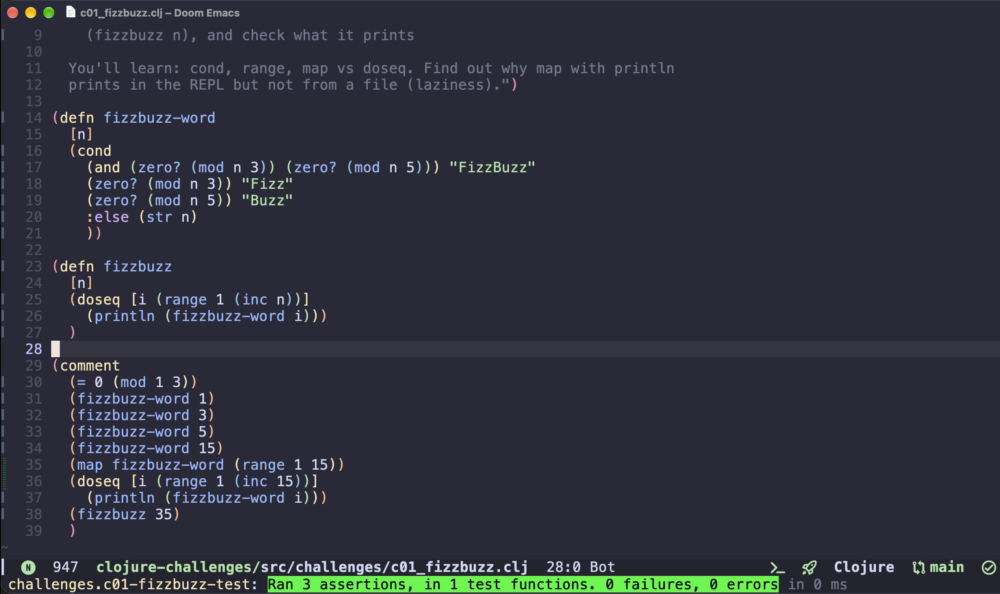
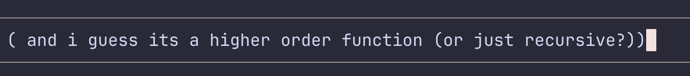

# Learning Clojure for the Weather Collector Take-Home

_Rick Copra, October 2026_

## AI disclosure

Up front, here's where I used AI this week:

- A reference implementation on Saturday, to see the shape of the program.
- My editor setup: porting my Neovim config to Doom Emacs, a REPL cheatsheet, and a generated Clojure coding challenge repo.
- Paired implementation of the HTTP server and scheduler on Monday, when time was running out.
- A final review: tests, a README draft, and a second pair of eyes on the code.
- Taking my chaotic scribbles and turning them into this doc.

---

Before this week I had never written a line of Clojure. I'd done a couple of guided Go projects ([gator](https://github.com/rcopra/gator), [chirpy](https://github.com/rcopra/chirpy)). Before that it was just Rails life. No Lisp, no real FP.

## Wednesday – Friday (Oct 14–16)

After my interview with the COO and receiving the take home, I spent the first day setting up my editor and reading the Clojure overview. I made the very pragmatic decision to ditch Neovim so I could get the full GUI REPL experience. The [official editors guide](https://clojure.org/guides/editors) recommends Emacs first... but I made the second very pragmatic decision to decide against learning Emacs to do a case study. I begrudgingly reinstalled VS Code, installed Calva, and quickly ran a hello world in the REPL. Really cool dev ex.

Then I came down with a cold, and moving house and my daughter's fall break took priority. I squeezed in some reading and REPL experiments, and tried to review some OSS codebases to grasp the shape of idiomatic Clojure. Lisp syntax broke my brain, and I got a little scared. The pressure is on.

## Saturday (Oct 17 · the first "proper" day)

Before writing anything, I had Claude Code generate a solution from the assignment PDF, just to see the shape of a service like this in Clojure: how many namespaces, roughly how many lines. Beyond that it wasn't much help, and I didn't spend much time in the code. I did ask it two things, which became my bar for my own version: is this idiomatic, would a seasoned Clojure dev write it in this shape? And is anything over-engineered or overly defensive? I'd prefer edge case bugs over complexity. [Grug Brained Developer](https://grugbrain.dev) rules.

The plan was to get a feel for the language with some coding challenges in the REPL, then write the program from scratch, using the generated code only as a reference point when I got stuck.

### Picking the stack

My rule: stick to what each library's own README shows, and only add what the assignment actually asks for.

- **Build tool.** I went with Leiningen over deps.edn, which I saw was typically recommended. Leiningen is easier.
- **clj-http and Cheshire.** The clj-http README quickstart is basically the whole weather call.
- **Ring and Jetty.** Coming from Rails, Ring clicked: it's basically Rack. A handler is just a function from a request map to a response map. One endpoint doesn't need a router.
- **A `future` and a `loop`** for scheduling. For "once an hour", a loop that sleeps for an hour is the simplest thing that works. Grug approves.
- **`spit` and `slurp`** for the CSV. Two columns, no quoting.

### The derail

_Here's the thing about me: I can get wrapped up in the chaos a bit. I sort of thrive in it._

So much for my second very pragmatic decision. I couldn't help myself. Why waste time configuring Calva keybinds for my really specific keyboard setup when I can just go all in and learn Emacs? I had an agent set up Doom Emacs and map my Neovim config over so I could keep my muscle memory. This line from the Doom Emacs README made me laugh:

> It is a story as old as time. A stubborn, shell-dwelling, and melodramatic vimmer—envious of the features of modern text editors—spirals into despair before he succumbs to the [dark side](https://github.com/emacs-evil/evil). This is his config.

Emacs turned out to be much less scary than I had anticipated.

I also bought _Getting Clojure_ after Jeffy mentioned it in our call. I needed a hands-on human walkthrough, and the author was a former Ruby dev. It also uses Leiningen, so I'm doing the same. This line was exactly what I needed to read:

> For now let's just note that the Clojure syntax for making something happen—such as calling a function—is to wrap the something in round parentheses, and move on.

I needed permission to move on from that hurdle, instead of fully wrapping my head around reading Lisp fluently. I also found "Parens of the Dead" on YouTube, which showed me what REPL driven development looks like in Emacs. And I noticed that clojure-lsp offered everything I loved about Go, supercharged with the REPL.

All this research felt really productive! But it ultimately was procrastination. Time to get coding.

## Sunday (Oct 18)

_Fizzbuzz kinda broke my brain, but I did it!_

At 1:45 PM on Sunday, I finally solved a coding challenge. Nice. I really enjoyed the scratchpad in the `(comment)` block. Felt really nice to code like that.

What tripped me up:

- `doseq` felt so strange. I missed Go's simple for loop. And why won't my iteration show when I evaluate the form? Because `doseq` returns nil!
- Finding the right seams for helper functions. I know it's the same as other languages, but it felt... different.
- My love for guard clauses. That's how I think, and I need to switch it up.

_Something I wrote to an agent. I guess I'm a proper Lisp programmer now._

I also joined the Clojurians Slack. deps.edn is the popular pick there as it's less heavy, but I stuck with Leiningen: lowest friction wins this week.

### Why Lisp?

By Sunday night I was churning hard on one question: what is Lisp actually _for_? A mentor who's learning Lisp right now gave me two answers I'm still unpacking:

> Operating directly on the AST, with the ability to do static and dynamic analysis as well as perform live evals [...] and how effective it is in building DSLs, which is 90% of what we do with libraries and packages anyway.

And on the REPL:

> Essentially the REPL is inception, it acts as an emulator inside the language running the language.

The FP side surprised me too. I thought since I understood Go arrays, immutable lists would be easy. You interact with them the same way, but I think they're entirely different under the hood. My inexperience is showing, but that's what I want!

Just after midnight, I ran `lein new`.

## Monday (Oct 19 · due date)

Bugs are fine, complexity is not. Grug brained. Let's do this.

I built it one namespace at a time: poking at it in a `(comment)` block until it did the thing, then wrapping it in a `defn`. Those comment blocks are still in the repo as a record of how it got built.

- **Weather.** I made my first real API call from the REPL, and Berlin came back at 12.55°C, right in the editor. Clojure is really so lovely to work with.
- **CSV storage.** I worked through `spit`, `slurp` and `.exists` one form at a time, and left a note to myself.
- **HTTP server and scheduler.** The clock was winning, so I leaned on the agent for these two, then pulled both apart in the REPL: called the handler with a hand-typed request map, started Jetty from inside the file (the REPL is so cool), and watched the hourly loop write rows.
- **Error handling.** I fed in a bad API key and dug in with `*e` and `ex-data`. clj-http puts the status and response body right in the exception data, so the log can say exactly why it failed.
- **Review.** I named the anonymous function I couldn't read (`parse-line`) and cut a malformed-row fix I didn't need.

## Where I landed

Dev ex in Clojure is nuts. This is one of the most satisfying weekends I've had as a programmer in a long while, and I haven't gotten such a huge level up in such a short period of time in ages. I can't explain _why_ yet. I want to say "it can do `this`, when Ruby does `that`", but I don't know if Ruby truly can't. Give me 6 months.

After my conversations with Jeffy and Judith, the role felt like a really positive fit. And they say Ruby is the epitome of dev happiness... I sincerely disagree at the moment! It's everything I was looking for, without really knowing it was what I was looking for. Clojure specifically.
